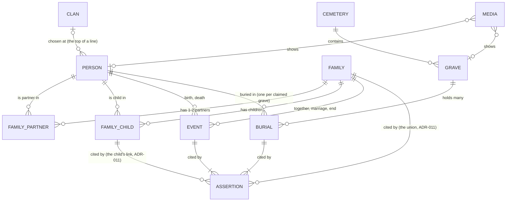

# Grobing — Data model

> **Żywy dom modelu danych.** Brief (`kickoff/PROJECT_BRIEF.md` §Architecture → *Data model*) jest
> zamrożonym zapisem decyzji z kick-offu; zmiany modelu trafiają **tutaj** (a zmiana schematu w kodzie —
> z migracją, [[NFR-003-migracje-schematu]]).
>
> Zbudowany z kanonu (brief, Step 0): rodzina jako rekord, wiele osób w grobie, zdarzenia z niepewną
> datą, nazwiska rodowe, **źródło przy faktach**. Pojęcia mapują się jeden do jednego na GEDCOM
> (individual, family, event, source + quality) — **bez importu i eksportu GEDCOM**, więc eksport (C2)
> zostaje tani.

## Entities

| Entity | Carries | Why this shape |
|---|---|---|
| **Person** | imiona · nazwisko · **nazwisko rodowe** · **płeć** (kobieta / mężczyzna, pusta = nieznana — `SEX` w GEDCOM 7; schemat v7, [[ADR-012-person-sex-and-union-timeline]]) · kim była (tekst) · `is_living` | nazwisko rodowe — [[FR-005-nazwisko-rodowe]]; `is_living` — **nieużywane**: żaden ekran go nie ustawia (domyślnie „nie żyje”), a od [[ADR-018-export-is-the-backup]] (2026-10-16) nic od niego nie zależy; zostaje w schemacie bez migracji. Kto nie żyje, mówi zapisany zgon albo pochówek ([[drzewo]] D22) |
| **Family** | **związek** (małżeństwo albo nie): 1-2 partnerów · dzieci (**według daty urodzenia**, bez daty na końcu — GEDCOM 7 „chronological by birth”, [[ISSUE-019-family-relations]] D4) · **oś czasu związku**: własne zdarzenia „razem od”, ślubu i końca — ślub albo koniec, o których wiadomo, że były, bez daty to zdarzenie bez daty (`MARR Y` w GEDCOM 7; [[ADR-012-person-sex-and-union-timeline]]); twierdzenie o parze przy rodzinie, o dziecku przy jego łączu ([[ADR-011-relation-claims-family-and-child-link]]) | osoba może być partnerem w kilku rodzinach → powtórne małżeństwo działa z konstrukcji ([[FR-002-rodzina-jako-rekord]]) |
| **Event** | typ · **data + kwalifikator** (dokładnie / około / przed / po / między) · miejsce | „ok. 1890" i „przed 1920" to normalne dane ([[FR-004-data-z-dopiskiem]]). Typy: osoby — urodzenie, zgon, **pochówek** (`glossary.md` → *pochówek*: data pochówku to Event, nie cecha powiązania); rodziny — **razem od** (od v7; eksport jako `EVEN` + `TYPE`), małżeństwo, koniec. Data może być nieznana przy zdarzeniu, o którym wiadomo, że było (ślub, koniec — v7). Diagram z briefu wymienia tylko birth, death |
| **Cemetery** | nazwa · miejscowość · punkt środka · **zdjęcie** (jedno, wiersz *Media* z `cemetery_id` — schemat v9, [[ADR-014-cemetery-photo-on-media]]) · **plan** (obrys i alejki z OSM, pobrany raz — tabela `cemetery_plans`, schemat v10, [[ADR-015-cemetery-plan-in-database]]; brak wiersza = jeszcze nie pobrany, zaślepka) · ~~link do Grobonetu albo wyszukiwarki zarządcy~~ — **wycofany** ([[cmentarz]] D12, [[SPIKE-004-mvp-flow-prototype]] D10; kolumna `grobonet_url` zostaje w schemacie, nikt jej nie zapisuje ani nie czyta — audyt R9 w [[ISSUE-032-mvp-install]]) | widok 1–2; plan — [[ADR-003-map-source-offline]] (2026-10-08). Ortofotomapa nie jest zapisywana (tylko online) |
| **Sector** (kwatera — schemat v11, [[ADR-016-sector-record-and-grave-link]]) | nazwa bez słowa „Kwatera” („81”, „B”) · klucz nazwy (bez wielkości liter i polskich znaków, **unikalny na cmentarzu** — „b” = „B”) · cmentarz · **strefa** zaznaczona przez autora (pierścień współrzędnych; opcjonalna — kwatera bez strefy żyje tylko w adresach). Kwatera bez strefy i bez grobów znika | dane autora, nie zarządcy — [[ADR-003-map-source-offline]] pkt 3. Rekord, na który wskazują groby: zmiana nazwy poprawia wszystkie adresy. Osobno od planu (plan kasuje się przy zmianie punktu — [[ADR-015-cemetery-plan-in-database]]) |
| **Grave** | **nazwa grobu** (`name`, opcjonalna, wpisuje autor — schemat v3, [[ISSUE-012-transcribe-grave-screen]]) · **kwatera / rząd / miejsce** (`sector_id` → *Sector* od v11, [[ADR-016-sector-record-and-grave-link]]; `row` / `plot` — tekst, bo zarządcy piszą „12a”, „IV”; wpisywane w „Popraw grób” od [[ISSUE-028-cemetery-sectors]]) · pozycja + **jak ją uzyskano** (pinezka postawiona na planie albo na ortofotomapie / GPS na miejscu — [[ADR-003-map-source-offline]]; `position_source`: `plan` · `satellite` · `gps`) + dokładność (tylko GPS) + **data zapisu** (v12, [[ISSUE-029-pin-on-site-gps]]) · zdjęcia nagrobka · **opłata ważna do** (S4 — `paid_until_year` / `_month` / `_day`, sam rok, miesiąc albo dzień, bez dopisku; puste = „nie wiadomo” — schemat v14, [[ISSUE-043-grave-paid-until]]) | adres zarządcy jest prawdą, pinezka pomocą |
| **Burial** | grób ↔ osoba, wiele na grób; osoba ma osobny wiersz dla każdego grobu, który podaje dla niej jakieś źródło | grób rodzinny mieści kilka osób ([[FR-003-wiele-osob-w-grobie]]); człowiek leży w jednym miejscu, ale źródła mogą się różnić ([[ADR-006-claimed-value-separate-structures]] D2) |
| **Assertion** (provenance) | **źródło** (nagrobek / notatki / babcia / krewny / akt) + szczegół (kto, który akt) · **status** `CLAIMED / CONFIRMED / CONTRADICTED / UNKNOWN` · kiedy — **przy wierszu *Event* albo *Burial***, którego wartość potwierdza, **albo przy rodzinie i łączu dziecka** (relacje, schemat v6 — [[ADR-011-relation-claims-family-and-child-link]]); wartość („co twierdzimy”) żyje w tym wierszu | cytowanie źródła jak w GEDCOM 7; **dwa sprzeczne twierdzenia współistnieją** jako dwa wiersze, każdy ze swoim twierdzeniem ([[FR-001-provenance]], [[ADR-006-claimed-value-separate-structures]]) **Od 2026-10-08 uśpione:** aplikacja nie pokazuje i nie zbiera źródła ani statusu ([[SPIKE-004-mvp-flow-prototype]] D28); kolumny zostają, formularz wpisuje domyślne źródło. |
| **Media** | **zdjęcie jako rekord** (jak `MULTIMEDIA_RECORD` w GEDCOM 7): plik w prywatnym magazynie aplikacji i, dla nagrobka, grób, a dla zdjęcia cmentarza — cmentarz (`cemetery_id`, schemat v9). **Zdjęcie = kopia dostępowa:** JPEG 2048 px, bez EXIF ([[ADR-008-photos-access-copy-and-backup-consistency]]); pliki `media/groby/<id>/…`, `media/cmentarze/<id>/…` i `media/zdjecia/<czas>-<losowe>.jpg` (zdjęcia osób, bez id osoby — bywają wspólne). **Grób i cmentarz — najwyżej jedno zdjęcie** (pierwsze = najniższe `id`; jedna droga zapisu). Usunięcie kasuje wiersz, plik usuwa sprzątanie (ADR-008 pkt 3). Wiersz bez grobu, bez cmentarza i bez łącza znika w tej samej transakcji ([[ADR-009-person-photos-record-and-link]], [[ADR-014-cemetery-photo-on-media]]) | oryginał zostaje w galerii albo na papierze |
| **PersonMedia** (łącze zdjęcia) | osoba ↔ zdjęcie z **pozycją** (jak `OBJE` w GEDCOM 7) — schemat v4, [[ISSUE-017-person-photos]]. **Profilowe = pierwsze łącze osoby**, osobno dla każdej osoby; jedno zdjęcie (np. grupowe) ma łącza od wielu osób, a plik jest jeden. Zmiany zdjęć osoby zapisują się w transakcji jej wpisu ([[ADR-009-person-photos-record-and-link]]) | kto jest na zdjęciu — bez źródła ([[FR-001-provenance]]: daty, relacje, pochówek; łącze w GEDCOM 7 nie ma `SOUR`). **Kadr profilowego** (schemat v5): `CROP` przy łączu — cztery kolumny `crop_*` w pikselach pliku zdjęcia; brak = środek; każda osoba na zdjęciu ma własny ([[ADR-010-profile-photo-crop-pixels]]). **Tło** (schemat v8): `is_background` przy łączu — najwyżej jedno na osobę (częściowy indeks unikalny), rozszerzenie aplikacji, bo łącze w GEDCOM 7 zna tylko `CROP` i `TITL` ([[ADR-013-person-background-on-photo-link]]) |
| **Residence** (zamieszkanie — schemat v13, [[ADR-020-residences-place-in-the-row]]) | osoba · **od** i **do** (każde z dopiskiem dokładnie / około, każde może być puste — okres `FROM … TO …` w GEDCOM 7) · **poziom miejsca** kraj / miejscowość / adres · **miejsce słowami w wierszu** (nazwa dziś, jednostka, kraj, punkt, id GeoNames) · nazwa z tamtego czasu · adres (tekst) | kopia czyta się bez listy miejsc z aplikacji; **puste „do” kończy się początkiem następnego zamieszkania — wyliczone przy odczycie, nie zapisane** (D12 w [[zamieszkanie]]). Lista miejsc (GeoNames, Natural Earth) to asset poza gitem i poza kopią |
| **Clan** (ród — schemat v15, [[ADR-021-clans-choice-at-the-person]]) | nazwa (unikalna bez wielkości liter i polskich znaków) · **klucz wzoru** wieńca (19 obrazów w aplikacji) · **klucz koloru** (12 kolorów palety). Przy osobie: **ród wybrany tutaj** (`clan_id`) albo **„bez wieńca”** (`no_wreath`) — zwykle tylko u szczytu linii | wieniec rodu przy portrecie i na drzewie ([[wieniec]]); **zapisany jest tylko wybór, wieniec liczy się z drzewa** po linii ojca, a kobieta po ślubie ma pół rodu własnego i pół rodu męża (reguły niżej). Ród odróżnia para wzór + kolor ([[wieniec]] D20) |
| **Setting: „ja"** | która osoba to autor | kotwica „jak łączą się ze mną" (M5). W kodzie: tabela `settings` od v1, jeden wiersz `id = 1`, zapisywany przy pierwszym wyborze w ustawieniach albo w zakładce Osoby ([[ISSUE-022-app-skeleton-tabs-people-settings]]); jedzie w kopii razem z bazą |

## Tables in `grobing.db` — schema v15 (for reading a backup without Grobing)

> Dopisane przy [[ISSUE-040-export-is-the-backup]] (2026-10-16, US-006 AC-2): **eksportem jest kopia** ([[ADR-018-export-is-the-backup]]), więc ktoś
> z bazą z kopii (`backup-format.md`) musi wiedzieć, która tabela to która encja wyżej. Kolumny i ograniczenia — schemat w samej bazie
> (`SELECT sql FROM sqlite_master`); wersja — `PRAGMA user_version`. Daty zdarzeń są w kolumnach liczbowych, nie w tekście.

| Tabela | Encja | Co w niej jest |
|---|---|---|
| `persons` | *Person* | imiona, nazwisko, nazwisko rodowe, płeć, „kim była” (`bio`), `bio_source` (ekrany zapisują zawsze „notatki”, żaden go nie pokazuje — [[SPIKE-004-mvp-flow-prototype]] D28) i `is_living` (nikt nie zapisuje, domyślnie 0 — nieużywane; audyt R9 w [[ISSUE-032-mvp-install]]), ród wybrany przy osobie (`clan_id`) i „bez wieńca” (`no_wreath`) — od v15 |
| `clans` | *Clan* | nazwa, klucz wzoru (`motif`, np. `klosy`), klucz koloru (`colour`, np. `rubin`) — od v15 ([[ADR-021-clans-choice-at-the-person]]) |
| `families` | *Family* | sam związek (id); partnerzy i dzieci w dwóch tabelach niżej, daty związku w `events` |
| `family_partners` | *Family* — partnerzy | para `family_id` ↔ `person_id`, 1–2 wiersze na rodzinę |
| `family_children` | *Family* — dzieci | `family_id` ↔ `person_id` dziecka; twierdzenie o łączu dziecka w `assertions` ([[ADR-011-relation-claims-family-and-child-link]]) |
| `events` | *Event* | typ (urodzenie, zgon, pochówek; razem od, małżeństwo, koniec), `person_id` **albo** `family_id`, data jako `qualifier` + `year`/`month`/`day` i druga data `year_to`/`month_to`/`day_to` przy „między”, miejsce (`place`) |
| `assertions` | *Assertion* | twierdzenie przy zdarzeniu, pochówku, rodzinie albo łączu dziecka: rodzaj źródła, opis, status, czas zapisu (bez ekranu od [[SPIKE-004-mvp-flow-prototype]] D28 — wiersze zostają) |
| `cemeteries` | *Cemetery* | nazwa, miejscowość, punkt środka (`center_lat`, `center_lon`); `grobonet_url` — link wycofany ([[cmentarz]] D12), kolumna pusta |
| `cemetery_plans` | *Cemetery* — plan | obrys i alejki z OSM jako JSON współrzędnych, status, czas pobrania, serwer ([[ADR-015-cemetery-plan-in-database]]) |
| `sectors` | *Sector* | kwatera cmentarza: nazwa, klucz nazwy, strefa (JSON współrzędnych, opcjonalna) ([[ADR-016-sector-record-and-grave-link]]) |
| `graves` | *Grave* | cmentarz, nazwa, kwatera (`sector_id`), rząd, miejsce, **pinezka** (`lat`, `lon`, źródło, dokładność w metrach, czas), **opłata ważna do** (`paid_until_year`, `_month`, `_day` — od v14) |
| `burials` | *Burial* | osoba ↔ grób |
| `media` | *Media* | ścieżka pliku względem `media/` w kopii (`relative_path`), `grave_id` (zdjęcie nagrobka) albo `cemetery_id` (zdjęcie cmentarza) |
| `person_media` | *PersonMedia* | osoba ↔ zdjęcie: pozycja (0 = profilowe), kadr w pikselach (`crop_*`, [[ADR-010-profile-photo-crop-pixels]]), czy tło ([[ADR-013-person-background-on-photo-link]]) |
| `residences` | *Residence* | osoba, `from_*` i `to_*` (dopisek, rok, miesiąc, dzień — puste dozwolone), `level`, `place_name`, `place_unit`, `country_code`, `country_name`, punkt (`lat`, `lon`), `geonames_id`, `name_then`, `address` ([[ADR-020-residences-place-in-the-row]]); koniec pustego `to_*` z następnego zamieszkania nie jest zapisany |
| `settings` | *Setting: „ja”* | jeden wiersz `id = 1`: `me_person_id` |

## Rules that are not tables

- **Ścieżka między dwiema osobami** = najkrótsza droga po krawędziach osoba–rodzina (partner, dziecko),
  pokazywana jako łańcuch („ja → żona → jej ojciec → …"). **Liczona, nigdy zapisywana.**
- **Wieniec rodu** = ród wybrany przy osobie, inaczej ród ojca (rodzic „mężczyzna” w pierwszej rodzinie, w której osoba jest dzieckiem), w górę
  linii; kobieta z małżeństwem — pół rodu własnego, pół rodu męża z ostatniego małżeństwa ([[wieniec]] B1–B7, [[ADR-021-clans-choice-at-the-person]]).
  **Liczony, nigdy zapisywany** — zapisany jest tylko wybór (`clan_id`, `no_wreath`).
- **Ziarnistość źródeł (decyzja kosztowa z kick-offu):** twierdzenia na **datach, relacjach i miejscu
  pochówku** — to, o co się spiera; „kim była" niesie jedną linię źródła. Źródło na każdym polu
  spowolniłoby przepisywanie ~100 osób (G6).
- **Gdzie żyje:** lokalny SQLite + zdjęcia w prywatnym magazynie aplikacji ([[ADR-001-local-first]]);
  kopia — [[ADR-004-backup-format-encryption-destination]]; eksportem danych jest kopia ([[ADR-018-export-is-the-backup]], 2026-10-16).
- **Usuwanie** ([[ADR-022-deletion-with-undo-snapshot]], 2026-10-23) = wiersze skasowane w jednej transakcji z migawką do „Cofnij”, **bez kosza i bez
  zmiany schematu**. Grób i cmentarz zabierają pochówki, nie osoby; osoba zabiera to, co jej (związek bez dwóch osób znika cały); „ja” się nie usuwa.

## In code

- **2026-10-05 — schemat v1** ([[ISSUE-007-data-layer]], [[ADR-005-sqlite-package]]):
  `grobing-code/lib/data/database.dart`. Są w nim wszystkie encje z tabeli wyżej **oprócz *Assertion***,
  a także bez opłaty za grób (S4, poza Must) i statusu mapy offline cmentarza ([[SPIKE-001-map-source-offline]]).
  Powód: model nie mówi, gdzie żyje wartość spornej daty, w *Event* czy w *Assertion*. *Assertion*
  przyjdzie jako v2 przy [[US-002-przepisanie-grobu]], z pierwszym prawdziwym testem migracji. Ta tabela
  się nie zmienia; to stan wdrożenia, nie korekta modelu.
- **2026-10-06 — schemat v2** ([[ISSUE-011-schema-v2-assertions]]). Odpowiedź na pytanie z v1: **wartość
  żyje w *Event* (data z dopiskiem) i w *Burial* (grób), a *Assertion* jest cytowaniem przy wierszu**, jak
  w GEDCOM 7. Sprzeczna wartość to osobny wiersz, a pokazuje się pierwszy
  ([[ADR-006-claimed-value-separate-structures]]). Tabela `assertions`; `burials` z `id`, bez UNIQUE na
  osobie, z UNIQUE (osoba, grób). Zapis faktów przez `grobing-code/lib/data/claims.dart`. Wiersze z v1
  dostały twierdzenie „notatki, przeniesione z v1”. Diagram i wiersze *Burial* / *Assertion* wyżej
  poprawione według ADR-006, więc to **korekta modelu**, nie tylko stan wdrożenia. Twierdzenia przy
  relacjach (diagram: „US-003”) jeszcze nie są w kodzie.
- **2026-10-06 — punkt cmentarza ma pisarza** ([[ISSUE-014-home-map-of-poland]]): `center_lat` / `center_lon`
  (od v1) zapisuje i poprawia ekran główny przez `grobing-code/lib/data/cemeteries.dart`; cmentarz bez punktu
  nie ma znicza na mapie. Bez zmiany schematu. Cmentarz to miejsce, a nie fakt o osobie, więc nie ma
  twierdzeń ([[FR-001-provenance]]).
- **2026-10-08 — schemat v6** ([[ISSUE-019-family-relations]], [[ADR-011-relation-claims-family-and-child-link]]): twierdzenia przy
  relacjach są w kodzie — `assertions.family_id` (para) i `assertions.family_child_id` (łącze dziecka, które dostało `id`);
  `CHECK`: twierdzenie cytuje dokładnie jeden wiersz. Zapis i usuwanie rodziny przez `grobing-code/lib/data/families.dart`
  (`saveFamily`, `deleteFamily`), w jednej transakcji, z regułami arkusza (1–2 osoby w parze, co najmniej dwie osoby,
  nikt dwa razy, dziecko w jednej rodzinie rodziców). Migracja v5→v6 nie dodała wierszy (rodziny sprzed v6 — tylko z
  danych debug — dostają twierdzenie przy pierwszym zapisie). **Płci w modelu nie ma** (decyzja autora; do v7); nazwy relacji
  na ekranie są neutralne.
- **2026-10-08 — schemat v7** ([[ISSUE-025-gender-kinship-together-since]], [[ADR-012-person-sex-and-union-timeline]]):
  `persons.sex` (`female` / `male`, pusta = nieznana; podpowiedź z imienia tylko na ekranie) i nowy typ zdarzenia rodziny
  `together` („Razem od”). Ślub i koniec bez daty to zdarzenia bez daty; `families.dart` → `saveFamily` dostaje `together`,
  `married`, `ended`. Migracja v6→v7 tylko dodaje kolumnę — kopie v6 odtwarzają się bez zmian w kodzie odtworzenia.
  Związki osoby według pierwszej daty związku (razem od, a bez niej ślub).
- **2026-10-12 — schemat v8** ([[ISSUE-024-person-view]], [[ADR-013-person-background-on-photo-link]]): `person_media.is_background`
  i indeks `person_media_background` (jedno tło na osobę). Tło zapisuje `applyPersonPhotoEdits` jak kadr — czyta przed
  przepisaniem łączy i oddaje; łącze usunięte zabiera tło. Migracja v7→v8 dodaje kolumnę i indeks, bez wierszy — kopie v7
  odtwarzają się bez tła. **Ścieżka od „ja” liczona, nie zapisywana:** `grobing-code/lib/data/kinship.dart` buduje graf z rodzin
  (rodzic, dziecko, rodzeństwo — dzieci tej samej rodziny, para) przy każdym otwarciu widoku osoby.
- **2026-10-12 — schemat v9** ([[ISSUE-023-poland-map-r1-cemetery-photo]], [[ADR-014-cemetery-photo-on-media]]): `media.cemetery_id`
  — zdjęcie cmentarza w arkuszu na mapie, zapisywane tą samą drogą co nagrobek (`photos.dart` → `setCemeteryPhoto`). Warunek
  sieroty w `applyPersonPhotoEdits` obejmuje cmentarz (inaczej „Zapisz” zdjęć osoby kasowałoby zdjęcia cmentarzy). Migracja
  v8→v9 tylko dodaje kolumnę — kopie v8 odtwarzają się z cmentarzami bez zdjęć.
- **2026-10-12 — schemat v10** ([[ISSUE-027-cemetery-map-plan-photo-states]], [[ADR-015-cemetery-plan-in-database]]): tabela
  `cemetery_plans` — plan cmentarza z OSM (status `ok`/`notInOsm`, obrys i alejki jako JSON samych współrzędnych, bez nazw i
  znaczników; czas pobrania, serwer). Jeden wiersz na cmentarz; nowy punkt kasuje plan w tej samej transakcji. Plan jest w kopii.
  Migracja v9→v10 to `createTable` — kopie v9 odtwarzają się bez planów, a cmentarze z punktem pobierają je, gdy jest sieć.
  **Pinezka grobu** (`graves.lat`/`lon`/`position_source`/`position_accuracy_m`, od v1) rysuje się od v10 jako znicz na planie;
  stawia się ją od [[US-008-pinezka-na-miejscu]].
- **2026-10-12 — schemat v11** ([[ISSUE-028-cemetery-sectors]], [[ADR-016-sector-record-and-grave-link]]): tabela `sectors` (nazwa,
  klucz nazwy unikalny z cmentarzem, strefa jako JSON pierścienia) i `graves.sector_id` zamiast tekstu `sector`. Migracja v10→v11:
  kwatera z każdego różnego klucza tekstu na cmentarzu, przebudowa `graves` bez tekstu (wiersze i `id` bez zmian), `foreign_key_check`
  — kopie v10 odtwarzają się z kwaterami jako rekordami. **Adres zarządcy pierwszy raz ma ekran** (okno „Popraw grób”, [[grob]] v6):
  do v11 kolumny były, ale zapisywały je tylko dane debug.
- **2026-10-12 — schemat v12** ([[ISSUE-029-pin-on-site-gps]]): `graves.position_recorded_at` — **data zapisu pinezki** (`NULL` dla
  pinezek sprzed v12, które pisały tylko dane debug). Źródło pinezki ma trzecią wartość, **`plan`** (obok `gps` i `satellite`), dopisaną na
  końcu; źródło jest zapisane nazwą, więc bez kroku migracji. Migracja v11→v12 to `addColumn` — kopie v11 odtwarzają się z pinezkami
  bez daty. **Pinezkę pierwszy raz stawia ekran** (tryb D [[cmentarz]] 12, z [[grob]] 4 albo z „Popraw pinezkę”): źródło = to, z czego
  wzięła się pozycja ([[cmentarz]] D33) — `gps` z dokładnością telefonu, `plan` albo `satellite` (ręka autora) bez dokładności. Pozycja
  telefonu: [[ADR-017-location-from-gnss-only]].
- **2026-10-16 — schemat v13** ([[ISSUE-042-places-of-residence]], [[ADR-020-residences-place-in-the-row]]): tabela `residences` z indeksem
  `residences_person`. Migracja v12→v13 to `createTable` — kopie v12 odtwarzają się z osobami bez zamieszkań. Zapis z „Zapisz” wpisu osoby, w jego
  transakcji; koniec pustego „do” wyliczany przy odczycie (`impliedEnds`, D12).
- **2026-10-16 — schemat v14** ([[ISSUE-043-grave-paid-until]]): `graves.paid_until_year`, `paid_until_month`, `paid_until_day` — **opłata ważna
  do** (brief S4) jak na naklejce albo pokwitowaniu, bez dopisku. Ten sam kształt co daty zamieszkań; liczby, nie tekst, żeby przypomnienie mogło
  później wyliczyć najbliższy termin. Bez twierdzeń (D28) i bez ADR — jedna opcjonalna wartość istniejącego rekordu, jak data pinezki w v12.
  Migracja v13→v14 to trzy `addColumn` — kopie v13 odtwarzają się z grobami „nie wiadomo”. Zapis w oknie „Popraw grób” razem z nazwą i adresem
  (`setGraveDetails`). **„Kto płaci” i przypomnienie — nie teraz** (decyzja autora w `/pm` 2026-10-16, wariant B).
- **2026-10-17 — schemat v15** ([[ISSUE-044-family-wreaths]], [[ADR-021-clans-choice-at-the-person]]): tabela `clans` (nazwa, klucz wzoru, klucz
  koloru) i `persons.clan_id`, `persons.no_wreath`. Migracja v14→v15 to `createTable` + dwa `addColumn` — kopie v14 odtwarzają się bez rodów i bez
  wieńców. Wybór rodu i ród zapisują się od razu z wiersza „Wieniec rodu” w poprawie osoby, nie z „Zapisz” ([[wieniec]] D16); wieniec liczy
  `WreathGraph` (`lib/data/wreaths.dart`) przy odczycie drzewa. **Usuwania rodu nie ma** (D16).
- **2026-10-23 — usuwanie, bez zmiany schematu** ([[ISSUE-053-delete-cemetery-grave-person]], [[ADR-022-deletion-with-undo-snapshot]]):
  `lib/data/deletion.dart` usuwa cmentarz (z grobami), grób (z pochówkami), pochówek osoby, osobę, pinezkę i **ród** (od teraz jest — wieńce wracają
  do reguły, [[wieniec]] D21); każde usunięcie zwraca migawkę, którą „Cofnij” wstawia z tymi samymi `id`. Kopia bez zmian formatu: usunięte wiersze
  po prostu w niej nie występują.

## Known consequence — not a model change

**Korekta autora (2026-10-05): notatki nie zawierają adresów kwater.** Grób przepisany z notatek ma
więc cmentarz i osoby, ale **ani adresu kwatery, ani pozycji** — oba powstają dopiero na miejscu (krok 6
UJ-001). Pola modelu zostają; nie mogą być wymagane przy wprowadzaniu. Jak taki grób znaleźć przy
pierwszej wizycie — ⚠️ **OPEN**, decyzja autora: `00_START_HERE/TRACEABILITY.md` → *Open gaps* 1.

**Decyzja autora (2026-10-06):** jeden wpis w notatkach = jeden nagrobek i osoby w nim, więc **Burial →
Grave zostaje wymagane** — model bez zmian. Gdyby przy przepisywaniu pojawił się wpis bez grobu, wraca
opcja „pochówek = osoba + cmentarz, grób opcjonalny” ([[US-002-przepisanie-grobu]] → *Open questions*).
